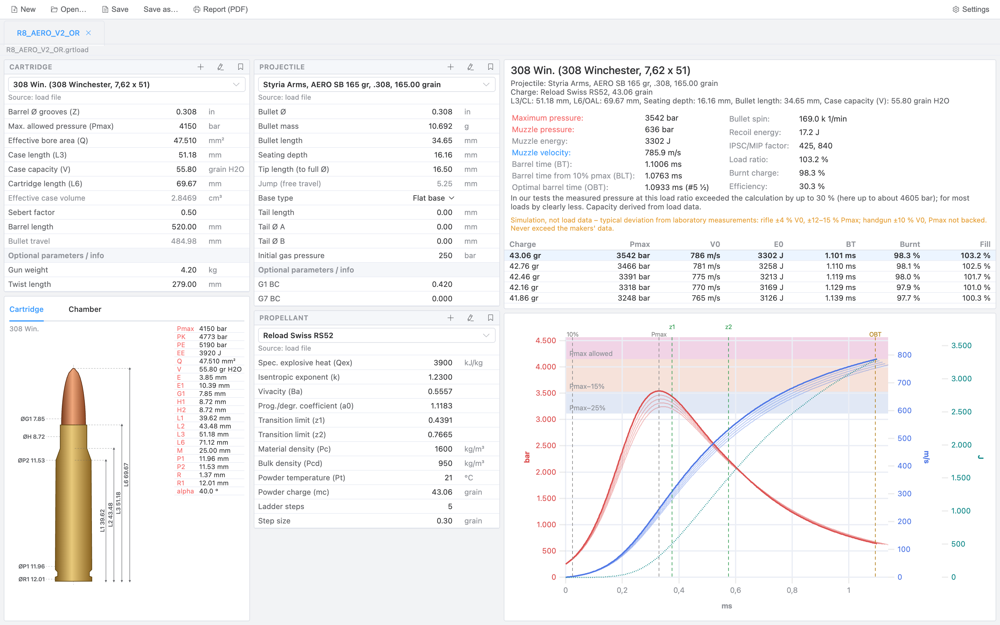

# BallisticaInterna — interior ballistics for reloaders

A cross-platform desktop application (Electron, Vue 3, TypeScript) for the interior ballistics of
rifle handloads. It opens and saves `.grtload` files.

Compatible with the .grtload file format of Gordon's Reloading Tool (not affiliated with, not checked by GRT).



Example report (PDF) of the same load, .308 Win. with a 165 grain bullet: [R8_AERO_V2_OR-report.pdf](docs/examples/R8_AERO_V2_OR-report.pdf)
(the load file: [R8_AERO_V2_OR.grtload](docs/examples/R8_AERO_V2_OR.grtload); `pnpm docs:media` makes screenshot and report from it)

> **Warning: simulation, not load data.** The calculated pressure can be too **low**: at low fill ratios (below
> about 90 %) the model calculates the gas pressure on average clearly too low (fill ratio below 80 %: Pmax about
> 15 % too low, single loads up to 43 %, [docs/MODEL.md](docs/MODEL.md#accuracy)), so the real pressure can be
> higher than shown. A calculation is never evidence that a load is safe: **never load on the basis of this app alone.** Use only the load data
> published by the powder and bullet makers, start with their starting load and never exceed their maximum load.
> Reloading is dangerous and can cause serious injury or death. The software is provided free of charge and
> without warranty; liability is excluded to the extent permitted by law (liability for intent, injury to life,
> body or health and in other mandatory cases remains unaffected). Full text: [DISCLAIMER.md](DISCLAIMER.md).

## Scope and limits (version 0.3)

- **Rifles only.** Handgun cartridges are in the caliber list, but there are no handgun powders and the model
  is not backed for them (velocity about ±10 %, pressure not measured). The app says so.
- **Low fill ratio:** below about 90 % the calculated pressure is too low (below 80 %: about 15 % on average,
  single loads up to 43 %). The app warns from a fill ratio below 90 %, below 85 % as a danger, and for slow
  powders below 85 % of the secondary explosion effect.
- **Velocity** deviates about 4 % (rms) from the makers' measured loads, **pressure** about 12 % (magnum) to 13 %
  (standard) rms, about 14 % on loads held out of the fit ([docs/MODEL.md](docs/MODEL.md#accuracy)). The pressure
  is not a safety margin.
- **Powders:** 39 models of Reload Swiss (9), Vihtavuori (19), Norma (6) and Rottweil (5), fitted to makers'
  published laboratory loads (Vihtavuori: its velocities with Sax's measured pressures). Powders of other makers
  can be added as own entries.
- **Bullets:** about 1640 from the makers' published data. A bullet length that no maker or JBM publishes stays
  empty and is marked: measure it yourself. Case capacities are derived from Reload Swiss's load data (34 rifle
  calibers) or estimated from the C.I.P. outline, and the app says which; enter the measured value of your cases.

## Features

- Load editor for caliber, bullet and powder, with BallisticaInterna's master data (C.I.P. calibers, maker bullet
  data, own powder models) and an own library (new calibers, bullets and powders, or master records as own
  copies); only bullets that fit the chosen caliber are offered
- Missing or wrong inputs are listed with the name of their field and marked in the input panels
- The jump of the bullet to the lands (C.I.P. freebore, cartridge length, tip length): below 1.5 mm the results
  warn to raise the start pressure to about 800 bar
- Warnings next to the result: fill ratio below 90 % (pressure too low), slow powder loosely filled (secondary
  explosion effect), estimated case capacity, and how far the measured pressure exceeded the calculation in the
  tests at this fill ratio
- Notes on taken data: bullet length missing or taken from JBM's list, estimated bulk density of a powder
- Accuracy stated per caliber class against the makers' measured loads ([docs/MODEL.md](docs/MODEL.md#accuracy))
- Asks before closing a load with unsaved changes; switched display units hold for every load
- Pressure, velocity and bullet energy over time, with Pmax bands and marks (10 % Pmax, Pmax, z1, z2, OBT)
- Load ladder and comparison of several loads in one chart
- Cartridge and chamber drawing from the C.I.P. dimensions
- PDF report with the load, the results, the chart and a warning box

## Layout

| path | content |
|---|---|
| `packages/solver` | the model: no UI, no I/O ([docs/MODEL.md](docs/MODEL.md)) |
| `packages/grtload` | `.grtload` reader and writer, units |
| `apps/desktop` | Electron app (Vue 3, Element Plus, uPlot) |
| `data/` | master data as CSV, with sources ([data/README.md](data/README.md)) |
| `tools/master-data` | builds `data/*.csv` into the app's SQLite database and checks every row |
| `tools/reference-data` | reads makers' published data (datasheets, catalogues) into `fixtures/`; steps for sources whose terms do not allow shipping or processing the data, and the scrapers of makers' web pages, are local-only and not in the repository |
| `scripts/` | model checks: `reference` (model vs. measured loads), `accuracy` (per caliber class), `fit-powders`, `calibrate`, `estimate-bulk-density` |
| `fixtures/` | local reference data: own loads, makers' load data (not in git, not redistributed) |

## Installation

Installers for macOS, Windows and Linux are attached to each release on GitHub. They are not signed with a certificate yet (macOS: ad hoc signature only, not notarised; see [#1](https://github.com/kiliankoller/ballistica-interna/issues/1) and [#2](https://github.com/kiliankoller/ballistica-interna/issues/2)):
- macOS: open the `.dmg`, drag the app to Applications and start it. macOS says it cannot check the app for malware: open System Settings → Privacy & Security, scroll down and click "Open Anyway" (once).
- Windows: Windows may show "Windows protected your PC": More info → Run anyway.
- Linux: `chmod +x BallisticaInterna-*.AppImage`, then run it.

## Development

Needs Node.js 22, pnpm 8 and Python 3 (master data build).

```sh
./run.sh         # build the master data and start the app (development mode)
./build.sh       # typecheck, tests, master data, notices and installer (--check: no installer, --no-test: no tests)

pnpm install
pnpm dev         # start the app
pnpm data        # data/*.csv → data/build/ballisticainterna.db
pnpm test        # unit tests
pnpm test:data   # master data checks
pnpm typecheck
pnpm reference   # model vs. measured loads in fixtures/
pnpm accuracy    # accuracy of the shipped powder models per caliber class
pnpm dist        # installer for the current platform (apps/desktop/dist)
pnpm docs:media  # screenshot and example report of docs/examples/*.grtload for this README
```

Pushing a version tag (`v*`) builds the installers for macOS, Windows and Linux on GitHub Actions and attaches
them to a release (`.github/workflows/release.yml`); started by hand, the workflow keeps them as artifacts.
Installers have no certificate for now (macOS: ad hoc signature only): macOS asks for confirmation on the first start
(System Settings → Privacy & Security → Open Anyway). A local installer is built on its own platform only (the SQLite module is native).

## Component data

BallisticaInterna ships its own master data (`data/`, see [data/README.md](data/README.md)): calibers from the C.I.P.
tables, bullets from makers' published data, powder models fitted to makers' published laboratory loads; each
record names its source. Master data is read only. Own calibers, bullets and powders (e.g. a caliber with the
measured capacity of your cases) are kept apart in a library: create them in a form, or take a master record
over as an own copy. Case capacities are estimated from the C.I.P. outline where no measured value is known;
measure your own cases.

## License

Copyright (C) 2026 Kilian Koller

- **Code:** GPL-3.0-or-later, see [LICENSE](LICENSE).
- **Data** (`data/*.csv`): Open Database License (ODbL) 1.0, <https://opendatacommons.org/licenses/odbl/1-0/>, see
  [data/LICENSE-DATA.md](data/LICENSE-DATA.md) (the full text is in `data/ODbL-1.0.txt`). Attribution is required.
  The data contains facts published by cartridge, bullet and powder makers and by the C.I.P. (cartridge and
  chamber dimensions and pressures: C.I.P. TDCC, public part, retrieved 2026-10-19); the source of each record
  is stated in `data/sources.csv`.
- Third-party software: see [NOTICE](NOTICE).
- Trademarks and product names belong to their owners and are used only to identify components. BallisticaInterna is
  not affiliated with, endorsed by or sponsored by any maker, the C.I.P. or GRT.

## Contact and contributions

Questions, errors and wrong values: issues on GitHub. Security problems: private vulnerability reporting
([SECURITY.md](SECURITY.md)). No outside contributions for now ([CONTRIBUTING.md](CONTRIBUTING.md)). There are no
donations or sponsoring.
